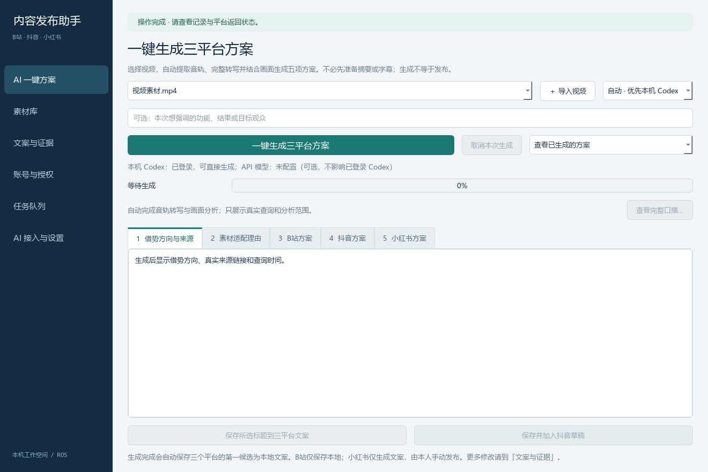

# 三平台内容发布助手 · TriContent Studio

> 安装包正在上传，Release暂未公开；源码和说明可先查看。待分卷上传与校验完成后开放软件下载。

Windows AI内容工作台：选择视频，自动转写完整口播、分析抽样画面，生成B站、抖音和小红书的差异化文案。

**当前版本：R05 / 1.4.0。小红书仅生成和导出文案，必须人工上传发布。**

[下载安装包](https://github.com/Wangmarco123/tri-content-studio/releases/tag/v1.4.0-r05) · [人工发布说明](docs/manual-xhs-r05.md) · [AI接口](docs/ai-interface.md) · [第三方许可](licenses/THIRD-PARTY-NOTICES.md)



## 能做什么

- 从所选视频的完整主音轨自动转写，结合最多8张抽样画面与公开来源生成内容；机器转写仍需核对专有词。
- 提供相关方向、来源链接和查询时间，并解释与视频画面、功能或结果的对应关系。
- B站：标题候选、简介、投稿TAG、分区建议。
- 抖音：短文案、第一句钩子、相关话题。
- 小红书：标题候选、短配文、搜索关键词、相关话题，支持导出人工发布文本。
- B站与抖音提供账号授权、任务队列、作品查询和发布回读；同视频按内容散列防止重复提交，结果不明时不自动重发。
- AI可通过本机HTTP、JSON命令行和stdio MCP调用，当前共21项MCP工具。

## 下载与安装

打开 [R05下载页](https://github.com/Wangmarco123/tri-content-studio/releases/tag/v1.4.0-r05)，把下面三个文件下载到**同一个文件夹**，运行EXE：

1. `TriContentStudio-1.4.0-R05-Setup.exe`
2. `TriContentStudio-1.4.0-R05-Setup-1.bin`
3. `TriContentStudio-1.4.0-R05-Setup-2.bin`

BIN是安装程序的分卷数据，不能漏下或改名。GitHub自动生成的“Source code”压缩包是源码，不含可直接运行的软件和模型。可用同页的`SHA256.json`核对安装文件。

共享安装版默认安装在当前用户的`LocalAppData/Programs/TriContentStudio`，可在安装时更换目录，无需有G盘。支持Windows 10/11 x64；未提供代码签名。安装包约2.3GB，包含本地语音模型、所需运行库和浏览器组件；安装后请预留额外空间存放视频分析和任务数据。

## 首次使用

1. 启动软件，导入或选择视频，点击“一键生成三平台方案”。
2. AI默认优先调用本机已安装且已登录的Codex；也可自行配置支持图像与JSON的API服务。软件不提供AI账号、API Key或平台账号。
3. 核对来源、标题、正文和话题。小红书在“文案与证据”中选择文案后点击“导出小红书人工发布文案”，由本人在官方App或网页选择视频并发布。
4. B站、抖音的登录扫码和验证码由本人完成；发布需明确选择范围。B站仅自己可见也是一次实际投稿。

小红书的自动登录、查询、草稿、上传与发布已移除；旧调用会被拒绝，不另行提供脚本绕过。安装包不含开发者的平台会话、Cookie、API Key、个人视频或任务数据库。

## AI接入

应用运行后，使用`ContentCtl.exe`读取状态或开启MCP：

```powershell
.\ContentCtl.exe status
.\ContentCtl.exe mcp
```

HTTP只监听本机，使用当前安装生成的本地Bearer token；请不要公开token文件。完整命令、接口与schema见 [AI接口说明](docs/ai-interface.md)、[OpenAPI](docs/openapi.json) 和 [作品查询说明](docs/publications-r04.md)。`studio_status`可查看`automatic_platforms`与`manual_platforms`。

## 源码与构建

本仓库是当前R05的干净源码快照，不包含个人开发历史或运行账号数据。Windows源代码依赖见`requirements-build.txt`与`requirements-lock-r03.txt`，构建入口为`scripts/build_windows.py`和`scripts/installer.iss`。构建前需按脚本要求准备固定版本的模型、CUDA可分发DLL、FFmpeg、biliup及浏览器组件；源码下载不会自动带上这些大文件。可在Windows运行`python -m unittest discover -s tests -q`检查代码，涉及浏览器/FFmpeg的检查还需相应本地组件。

## 验证与使用边界

R05在开发机完成200项自动检查和原生EXE隔离验收；小红书7种自动操作均在浏览器启动前被拦截。此记录不代表所有电脑、账号与后续平台页面均验证兼容。B站、抖音部分功能依赖平台当前页面与登录状态，并非全套官方发布API。平台可要求额外验证、限制操作或审核作品；不承诺规避风控、审核通过、流量或“爆款”。

画面分析是抽帧，不等于逐帧观看。榜单、网页与AI检索覆盖有限，没有相关方向时应直接说明，不能编造热点、亲身体验或作品结果。

## 许可与反馈

公开共享软件与源码不等于已授予原创代码的通用开源许可；当前未选择MIT等原创代码许可证，参见[NOTICE](NOTICE.md)。第三方组件保留各自许可证与来源，Qt共享库替换及相应权利见[Qt说明](docs/qt-relink.md)。

可在[Issues](https://github.com/Wangmarco123/tri-content-studio/issues)报告版本、系统、复现步骤和脱敏错误信息；请勿上传账号会话、Cookie、token或个人素材。
